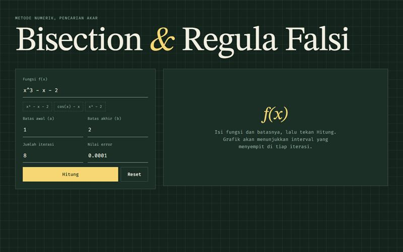

# Kalkulator Numerik

Pencari akar persamaan dengan Bisection dan Regula Falsi, lengkap dengan grafik.

**Demo:** https://portofolio-jauza-fawaid.netlify.app/KALKULATOR-NUMERIK/



## Fitur

- Metode Bisection dan Regula Falsi
- Grafik fungsi dengan penggeser iterasi
- Tabel iterasi dan contoh fungsi
- Validasi masukan dan syarat f(a)f(b) < 0

## Menjalankan

```bash
npm install
npm run dev
```

## Teknologi

Next.js, React, TypeScript, math.js
